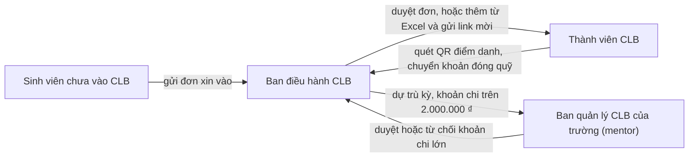

# Luồng người dùng của CampusHub

*Cập nhật ngày 05/10/2026, theo bản MVP dùng dữ liệu mẫu. Viết cho cả nhóm, kể cả người không làm kỹ thuật.*

File này kể **ai làm gì, theo thứ tự nào** trong CampusHub. Mỗi luồng có: ai làm, các bước, luật cần nhớ, và phần bản demo chưa có. Cuối mỗi luồng có tên màn và đường dẫn trong bản demo, cho người cần mở thử hoặc sửa code.

Muốn thử ngay: chạy bản demo (xem [README](../README.md)), mở http://localhost:3000/login rồi bấm một vai trong bảng tài khoản mẫu. Trang http://localhost:3000 là trang giới thiệu cho người chưa đăng nhập, có hai video demo.

## Bốn nhóm người dùng

| Nhóm người dùng | Cách gọi trong nhóm | Dùng trên | Luồng của nhóm này |
|---|---|---|---|
| Ban điều hành CLB: chủ nhiệm, phó chủ nhiệm, thủ quỹ, trưởng ban | Staff | Laptop | 1, 2 (duyệt đơn), 3, 4, 5, 6, 7, 8 |
| Thành viên CLB | Khách hàng | Điện thoại | 1 (nhận lời mời), 3 (quét mã), 4 (đóng quỹ), 9 |
| Sinh viên chưa vào CLB | Khách hàng | Điện thoại | 2 |
| Ban quản lý CLB của trường (SRO, PDP), kiêm mentor | Quản lý | Laptop | 6 (duyệt khoản lớn), 10 |

Cách gọi "khách hàng, staff, quản lý" lấy từ `docs/ke-hoach-mvp.md`, mục 4; nhóm còn chờ chốt cách gọi này.

## Bức tranh chung

Tiền **không** đi qua CampusHub: thành viên chuyển thẳng vào tài khoản của CLB hoặc thủ quỹ. CampusHub chỉ ghi sổ và giúp đối chiếu.

## Từ ngữ dùng trong file này

| Từ | Nghĩa |
|---|---|
| Ban điều hành | Chủ nhiệm, phó chủ nhiệm, thủ quỹ và trưởng ban của một CLB |
| Mentor | Cán bộ của trường theo dõi CLB, duyệt các khoản chi lớn |
| Mã thành viên | Mã riêng của mỗi người trong CLB, ví dụ `A017`. Dùng trong nội dung chuyển khoản |
| Đợt thu | Một lần thu quỹ, ví dụ "Quỹ học kỳ Fall 2026", có mức thu và hạn đóng |
| Mã đợt | Phần đầu nội dung chuyển khoản của một đợt thu, ví dụ `QFALL26`. Nội dung đầy đủ: `QFALL26 A017` |
| Sao kê | File liệt kê các giao dịch, tải từ app ngân hàng |
| Đối soát | So sao kê với danh sách người phải đóng, để biết ai đã đóng |
| Gán tay | Thủ quỹ tự chọn giao dịch nào là của ai, khi máy không tự khớp được |
| Sổ quỹ | Danh sách mọi khoản thu, chi của CLB. Chỉ được thêm, không sửa, không xóa |
| Dự trù | Kế hoạch chi tiêu của CLB trong một học kỳ, theo từng hoạt động |
| Hoàn ứng | Một người đã tự bỏ tiền chi trước cho CLB, giờ xin CLB trả lại |
| Điểm danh tay | Ban điều hành tự đánh dấu một người có mặt, khi người đó không quét mã được |
| Học kỳ | Kế hoạch, thu quỹ và báo cáo tính theo học kỳ, mỗi năm 3 kỳ |

---

## 1. Lập CLB và đưa thành viên vào

**Ai làm:** chủ nhiệm (người tạo CLB), sau đó từng thành viên.

1. Một sinh viên đã đăng nhập bấm **"Tạo CLB mới"**, điền tên CLB, lĩnh vực, lịch sinh hoạt, địa điểm, học kỳ. Người tạo trở thành chủ nhiệm.
2. Trang chủ của CLB mới nhắc 3 việc đầu tiên: thêm thành viên, tạo buổi sinh hoạt, tạo đợt thu.
3. Chủ nhiệm (hoặc phó chủ nhiệm, trưởng ban) vào **Thêm thành viên**:
   - tải lên file Excel (`.xlsx`) hoặc `.csv` với các cột Họ tên, Email, Ban, Năm học; hoặc gõ tay từng người;
   - dòng nào sai (thiếu tên, email sai, trùng email, người đã ở CLB) thì báo ngay ở dòng đó để sửa trước khi thêm.
4. Mỗi người được thêm có một **link mời riêng**. Bản demo chưa gửi email, nên ban điều hành sao chép link và gửi qua Zalo.
5. Thành viên mở link mời trên điện thoại, đăng nhập Google, rồi đánh dấu các ô đồng ý:
   - lưu dữ liệu để quản lý thành viên (bắt buộc);
   - xác nhận đã đủ 16 tuổi (bắt buộc);
   - lưu số điện thoại (không bắt buộc).
6. Bấm **"Tham gia CLB"** là vào CLB. Không muốn vào thì bấm "Không tham gia".

**Luật cần nhớ**
- Ô đồng ý không bao giờ đánh dấu sẵn. CampusHub lưu lại ai đồng ý, lúc nào, với phiên bản chính sách nào.
- Chủ nhiệm đổi được vai trò và ban của thành viên. Đổi chủ nhiệm thì làm ở luồng bàn giao.
- Người mới chỉ phải đóng đợt thu đang mở của học kỳ hiện tại, không phải đóng các đợt cũ.

**Chưa có trong bản demo:** gửi email mời; người tạo CLB chưa phải xác nhận đủ 16 tuổi (để vậy khi còn dùng dữ liệu mẫu).

*Màn trong bản demo:* Tạo CLB `/clubs/new` · Trang chủ CLB `/clubs/<mã CLB>` · Thêm thành viên `/clubs/<mã CLB>/members/add` · Thành viên `/clubs/<mã CLB>/members` · Lời mời `/invite/<mã mời>`

## 2. Sinh viên xin vào CLB

**Ai làm:** sinh viên chưa vào CLB, rồi ban điều hành.

1. Sinh viên mở **Danh sách CLB**: thấy các CLB của trường đang dùng CampusHub, lĩnh vực, số thành viên, lịch sinh hoạt, CLB có đang nhận đơn không.
2. Mở trang một CLB, điền **đơn xin vào**: họ tên (lấy từ tài khoản Google), năm học, lý do (không bắt buộc), và đánh dấu đồng ý cho ban điều hành xem thông tin để xét đơn.
3. Ban điều hành thấy đơn ở trang chủ và màn **Thành viên**, rồi duyệt hoặc từ chối.
4. Được duyệt: sinh viên thấy nút **"Xem lời mời"**, rồi làm tiếp như bước 5–6 của luồng 1.
5. Bị từ chối: sinh viên thấy nhãn "Đơn bị từ chối" và gửi lại đơn được.

**Luật cần nhớ:** chỉ chủ nhiệm, phó chủ nhiệm và trưởng ban duyệt đơn.

*Màn trong bản demo:* Danh sách CLB `/explore` · Trang CLB và đơn `/explore/<mã CLB>`

## 3. Điểm danh buổi sinh hoạt

**Ai làm:** ban điều hành (người mở điểm danh) và thành viên.

1. Trước buổi: ban điều hành vào **Các buổi**, tạo buổi sinh hoạt (tên, ngày giờ, địa điểm, điểm danh mở đến mấy giờ). Chỉ tạo được buổi chưa diễn ra. Buổi chưa mở điểm danh thì còn sửa, xóa được.
2. Trong buổi: mở **Chiếu QR điểm danh** trên laptop hoặc máy chiếu, bấm **"Bắt đầu điểm danh"**. Mã QR đổi mỗi 30 giây.
3. Thành viên quét mã bằng camera điện thoại. Điện thoại mở trang điểm danh; chưa đăng nhập thì đăng nhập xong sẽ quay về đúng trang đó.
4. Điểm danh xong, thành viên thấy giờ điểm danh và số buổi đã tham gia trong kỳ. Màn chiếu hiện tên người vừa điểm danh và số người đã có mặt.
5. Ai quên điện thoại: ban điều hành chọn tên người đó để **điểm danh tay**.
6. Hết giờ: bấm **"Đóng điểm danh"**. Sau khi đóng vẫn điểm danh tay được.

**Luật cần nhớ**
- Mỗi điện thoại chỉ điểm danh cho một người trong một buổi.
- Điểm danh tay luôn ghi lại tên người làm.
- Không lấy vị trí (GPS) của ai.
- Quét mã bị lỗi thì màn báo rõ lý do: buổi chưa mở, đã đóng, mã sai, mã hết hạn, người quét chưa là thành viên, chưa nhận lời mời, điện thoại đã điểm danh cho người khác.

*Màn trong bản demo:* Các buổi `/clubs/<mã CLB>/events` · Chiếu QR `/clubs/<mã CLB>/events/<mã buổi>/qr` · Quét mã `/checkin` · Lịch sử điểm danh của thành viên `/me/attendance`

## 4. Thu quỹ

**Ai làm:** thủ quỹ hoặc chủ nhiệm, và thành viên.

1. Thủ quỹ **tạo đợt thu**: tên, mức thu mỗi người, hạn đóng, mã đợt, người nhận tiền, tài khoản ngân hàng nhận tiền.
2. Mọi thành viên có một dòng **"Chưa đóng"** trong đợt thu.
3. Thủ quỹ bấm **"Sao chép link đóng quỹ"** và gửi vào nhóm Zalo của CLB.
4. Thành viên mở link. Màn đóng quỹ hiện số tiền, hạn đóng, mã QR chuyển khoản, **nội dung chuyển khoản riêng** (ví dụ `QFALL26 A017`) và tên người nhận kèm vai trò.
5. Thành viên chuyển khoản bằng app ngân hàng, rồi bấm **"Mình đã chuyển khoản"**. Trạng thái thành "Chờ thủ quỹ xác nhận".
6. Thủ quỹ thấy người đó ở nhóm "Báo đã chuyển". Tiền về thì xác nhận bằng luồng đối soát (luồng 5), hoặc bấm **"Ghi nhận tay"** nếu đã tự thấy tiền trong app ngân hàng.
7. Ai đóng tiền mặt: thủ quỹ bấm **"Ghi tiền mặt"**.

**Luật cần nhớ**
- Tiền đi thẳng vào tài khoản người nhận. CampusHub không giữ tiền.
- Màn đóng quỹ chỉ hiện 4 số cuối của tài khoản.
- Mỗi lần ghi tiền đều hỏi lại trước, vì sổ quỹ không sửa, không xóa được.
- Hạn đóng sửa lúc nào cũng được. Mức thu chỉ sửa được khi chưa ai đóng hay báo đã chuyển.

**Chưa có trong bản demo:** mã QR là mã giả, dưới mã có dòng "Bản demo: mã này không chuyển tiền được". Bản thật dùng mã VietQR.

*Màn trong bản demo:* Đợt thu `/clubs/<mã CLB>/collections/<mã đợt>` · Tạo đợt thu `/clubs/<mã CLB>/collections/new` · Đóng quỹ của thành viên `/me/pay/<mã đợt>`

## 5. Đối soát sao kê

**Ai làm:** thủ quỹ hoặc chủ nhiệm.

1. Thủ quỹ tải file sao kê từ app ngân hàng (dạng CSV, 4 cột: ngày, số tiền, người chuyển, nội dung). Chưa rõ định dạng thì bấm "Tải file CSV mẫu" để xem.
2. Vào **Đối soát sao kê**, tải file lên. CampusHub chia giao dịch thành 3 nhóm:
   - **Khớp tự động:** đúng mã thành viên, đúng số tiền. Người đó chuyển sang "Đã đóng" ngay.
   - **Cần gán tay:** có lý do đi kèm, ví dụ thiếu mã thành viên, một lần chuyển cho nhiều người (chuyển hộ), thiếu tiền, sai cú pháp.
   - **Không thuộc đợt thu:** ví dụ tiền lãi, tiền hoàn ứng, tiền của đợt thu khác.
3. Với mỗi giao dịch cần gán tay, thủ quỹ bấm **"Ghi nhận"** theo gợi ý, hoặc chọn đúng người rồi bấm "Ghi nhận". CampusHub hỏi lại trước khi ghi vào sổ.
4. Màn cũng liệt kê những người đã báo chuyển mà chưa thấy trong sao kê. Giao dịch về trễ sẽ có ở lần tải sau.

**Luật cần nhớ**
- Chưa bấm "Ghi nhận" thì sổ quỹ chưa đổi.
- Tải lại cùng một file không ghi tiền hai lần.
- Người đã đóng rồi mà chuyển thêm: phần tiền đó ghi là "đóng thừa".
- Khoản đã "Ghi nhận tay" trước đó: khi dòng sao kê của khoản đó về, chỉ nối hai bên với nhau, không ghi lần hai.
- CLB có nhiều đợt thu: mở màn đối soát từ màn Đợt thu của đúng đợt đó.

**Chưa có trong bản demo:** hoàn tiền khi thành viên chuyển nhầm; nút "Nhắn hỏi" người đã báo chuyển.

*Màn trong bản demo:* Đối soát `/clubs/<mã CLB>/reconcile` (thêm `?dot=<mã đợt>` để chọn đợt)

## 6. Đề xuất và duyệt chi

**Ai làm:** người trong ban điều hành đề xuất; người khác trong ban duyệt; mentor duyệt thêm khoản lớn; thủ quỹ ghi đã chi.

1. Người cần tiêu tạo **đề xuất chi** (chưa tiêu) hoặc **yêu cầu hoàn ứng** (đã tự bỏ tiền trước): tên khoản, số tiền, thuộc khoản dự trù nào, có chứng từ không, lý do.
2. Chủ nhiệm, phó chủ nhiệm hoặc trưởng ban **duyệt**, có thể ghi chú; hoặc **từ chối**, bắt buộc ghi lý do.
3. Khoản trên 2.000.000 ₫: sau khi ban điều hành duyệt, khoản chuyển sang **"Chờ mentor"** (luồng 10).
4. Khoản đã duyệt và tiền đã chi thật: thủ quỹ bấm **"Ghi đã chi vào sổ quỹ"**. Số dư quỹ và cột "Đã chi" của dự trù đổi theo.

**Luật cần nhớ**
- Không ai được duyệt hay từ chối khoản do chính mình đề xuất, kể cả mentor.
- Chứng từ không bắt buộc. Khoản chưa có chứng từ mang nhãn "Chưa có chứng từ", mọi thành viên đều thấy.
- Mọi thao tác được ghi vào lịch sử của khoản chi.
- Ngưỡng 2.000.000 ₫ đang để tạm, chưa chốt.

**Chưa có trong bản demo:** tải ảnh chứng từ lên (hiện chỉ ghi có hay không có chứng từ).

*Màn trong bản demo:* Đề xuất và duyệt chi `/clubs/<mã CLB>/expenses`

## 7. Dự trù kỳ

**Ai làm:** chủ nhiệm, phó chủ nhiệm hoặc thủ quỹ.

1. Mở **Dự trù kỳ**. Trên cùng là phép tính:
   **số dư hiện tại + tiền còn phải thu + trường hỗ trợ − dự trù còn phải chi = số dư cuối kỳ dự kiến.**
2. Thêm từng hoạt động: tên, thời gian, nguồn tiền, số tiền dự trù. Cột "Đã chi" tự lấy từ sổ quỹ.
3. Số dư cuối kỳ dự kiến âm thì ô cuối báo "Đang thiếu", kèm số tiền thiếu.
4. Xuất bản dự trù và **gửi cho mentor**.

**Luật cần nhớ:** "Tiền còn phải thu" cộng mọi đợt thu của kỳ. "Dự trù còn phải chi" chỉ tính phần chưa chi, vì phần đã chi đã bị trừ khỏi số dư rồi.

**Chưa có trong bản demo:** gợi ý dự trù theo các kỳ trước; file xuất ra là CSV, chưa đúng mẫu Excel của trường.

*Màn trong bản demo:* Dự trù kỳ `/clubs/<mã CLB>/budget`

## 8. Bàn giao nhiệm kỳ

**Ai làm:** chủ nhiệm khóa cũ, ban mới, mentor.

Bàn giao có 6 bước:
1. chọn ban mới;
2. chốt số dư;
3. đổi tài khoản nhận quỹ (thủ quỹ mới không dùng tiếp tài khoản của thủ quỹ cũ);
4. chuyển quyền quản trị khỏi email trường của chủ nhiệm cũ, vì email này bị thu hồi khi tốt nghiệp;
5. ban mới xác nhận;
6. biên bản bàn giao.

Theo thiết kế, ban cũ được xem thêm 30 ngày rồi thành thành viên cũ. Nút "Xuất toàn bộ dữ liệu (Excel)" ở màn Bàn giao dùng được bất cứ lúc nào.

**Chưa có trong bản demo:** mới làm được bước 3 (lưu tài khoản nhận quỹ mới, mã giao dịch chuyển số dư). Các bước 1, 2, 4, 5, 6 đang hiện dòng "Màn của bước này chưa có trong bản vẽ". Giới hạn 30 ngày của ban cũ mới là ghi chú trên màn, chưa có code thực hiện.

*Màn trong bản demo:* Bàn giao `/clubs/<mã CLB>/handover`

## 9. Dữ liệu cá nhân của thành viên

**Ai làm:** thành viên, trên trang **Của tôi**.

1. Xem thông tin của mình: tên, email, ban, số buổi đã điểm danh trong kỳ, trạng thái đóng quỹ.
2. **Tải dữ liệu của tôi** ra file Excel.
3. **Rút đồng ý** lưu số điện thoại.
4. **Rời CLB và xóa dữ liệu:** gửi yêu cầu xóa. Trang hiện một tờ lịch đếm 20 ngày, là hạn CLB phải xử lý.

**Luật cần nhớ:** khi xóa dữ liệu, các khoản đã đóng vẫn nằm trong sổ quỹ nhưng không còn tên người, để số dư không lệch. Luật dựa trên Luật 91/2025 và Nghị định 356/2025 về dữ liệu cá nhân.

**Chưa có trong bản demo:** ban điều hành xử lý yêu cầu xóa; thành viên tự sửa thông tin; xem sổ quỹ ở chế độ chỉ đọc; đổi CLB khi một người ở nhiều CLB.

*Màn trong bản demo:* Của tôi `/me`

## 10. Phía nhà trường

**Ai làm:** ban quản lý CLB của trường, kiêm mentor.

1. **Các CLB:** thấy bao nhiêu CLB có hoạt động trong 30 ngày, bao nhiêu CLB đã nộp dự trù. Bảng từng CLB: lĩnh vực, số thành viên, số buổi có điểm danh trong kỳ, hoạt động gần nhất, đã chi so với dự trù.
2. **Chi tiết một CLB:** chủ nhiệm, mentor, dự trù và số đã chi theo từng hoạt động, số buổi sinh hoạt, các khoản đang chờ mentor duyệt.
3. **Duyệt hoặc từ chối** khoản chi trên 2.000.000 ₫. Từ chối phải ghi lý do.
4. Tải bản dự trù của CLB, xuất bảng các CLB ra Excel.

**Luật cần nhớ:** phía trường chỉ thấy số tổng hợp. Trường không thấy danh sách thành viên, không thấy ai đóng quỹ bao nhiêu, và chỉ thấy các CLB đang dùng CampusHub.

**Chưa có trong bản demo:** xem đề nghị hỗ trợ của CLB; mục "Dự trù và báo cáo".

*Màn trong bản demo:* Các CLB `/school` · Chi tiết CLB `/school/clubs/<mã CLB>`

---

## Ai được làm gì trong CLB

Máy chủ kiểm tra quyền ở mọi thao tác. Nút nào người dùng không có quyền thì bị khóa, kèm một dòng ghi lý do.

| Việc | Chủ nhiệm | Phó chủ nhiệm | Thủ quỹ | Trưởng ban | Thành viên |
|---|:-:|:-:|:-:|:-:|:-:|
| Xem các màn của ban điều hành | ✓ | ✓ | ✓ | ✓ | |
| Duyệt đơn xin vào, thêm thành viên | ✓ | ✓ | | ✓ | |
| Đổi vai trò, ban của thành viên | ✓ | | | | |
| Tạo buổi, mở điểm danh, điểm danh tay | ✓ | ✓ | ✓ | ✓ | |
| Tạo đợt thu, ghi tiền, đối soát sao kê, ghi đã chi | ✓ | | ✓ | | |
| Đề xuất chi, yêu cầu hoàn ứng | ✓ | ✓ | ✓ | ✓ | |
| Duyệt, từ chối khoản chi (trừ khoản của chính mình) | ✓ | ✓ | | ✓ | |
| Lập dự trù, gửi cho trường | ✓ | ✓ | ✓ | | |
| Bàn giao nhiệm kỳ | ✓ | | | | |
| Điểm danh, đóng quỹ, xem và tải dữ liệu của mình | ✓ | ✓ | ✓ | ✓ | ✓ |

Ngoài CLB:
- Ai đã đăng nhập cũng tạo được CLB mới, xem danh sách CLB và gửi đơn.
- Ban quản lý CLB của trường chỉ vào được các màn của trường. Họ không vào được màn của ban điều hành CLB.

## Đăng nhập

- **Đăng ký** chỉ bằng tài khoản Google, vì cần email đã được Google xác minh. Dùng đúng email mà CLB đã dùng để mời.
- Ngay sau lần đầu, CampusHub hỏi đặt **tên tài khoản và mật khẩu** (bấm "Để sau" được). Tên tài khoản khác tên hiển thị và khác email.
- Từ lần sau, đăng nhập bằng Google, hoặc bằng tên tài khoản (hay email) kèm mật khẩu.
- Nhập sai mật khẩu 5 lần thì phải chờ 15 phút mới thử mật khẩu lại được; đăng nhập Google vẫn dùng được.
- **Quên mật khẩu:** đăng nhập bằng Google, rồi đặt mật khẩu mới trong 15 phút sau đó, không cần mật khẩu cũ.
- Đổi tên tài khoản hay mật khẩu: trang "Của tôi", mục "Đăng nhập".
- Bản demo: dưới ô đăng nhập có bảng tài khoản mẫu cho 7 vai, mật khẩu chung `CauLong#2026`; bấm một vai là điền sẵn. Phần này không có trong bản thật.
