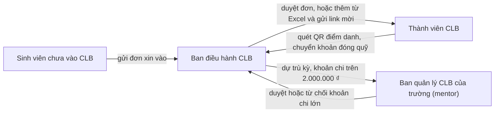

# Luồng người dùng của CampusHub

*Cập nhật ngày 23/10/2026, theo bản MVP dùng dữ liệu mẫu. Viết cho cả nhóm, kể cả người không làm kỹ thuật.*

File này có hai phần: **kể các luồng** (ngay dưới đây, mục 1 đến 10) và **kiểm thử bằng tay các luồng** (cuối file, mục K0 đến K11, có ô đánh dấu để người thử ghi kết quả).

File này kể **ai làm gì, theo thứ tự nào** trong CampusHub. Mỗi luồng có: ai làm, các bước, luật cần nhớ, và phần bản demo chưa có. Cuối mỗi luồng có tên màn và đường dẫn trong bản demo, cho người cần mở thử hoặc sửa code.

Muốn thử ngay: chạy bản demo (xem [README](../README.md)), mở http://localhost:3000/login rồi bấm một vai trong bảng tài khoản mẫu. Trang http://localhost:3000 là trang giới thiệu cho người chưa đăng nhập, có hai video demo.

## Bốn nhóm người dùng

| Nhóm người dùng | Cách gọi trong nhóm | Dùng trên | Luồng của nhóm này |
|---|---|---|---|
| Ban điều hành CLB: chủ nhiệm, phó chủ nhiệm, thủ quỹ, trưởng ban | Staff | Laptop | 1, 2 (duyệt đơn), 3, 4, 5, 6, 7, 8 |
| Thành viên CLB | Khách hàng | Điện thoại | 1 (nhận lời mời), 3 (quét mã), 4 (đóng quỹ), 9 |
| Sinh viên chưa vào CLB | Khách hàng | Điện thoại | 2 |
| Ban quản lý CLB của trường (SRO, PDP), kiêm mentor | Quản lý | Laptop | 6 (duyệt khoản lớn), 10 |

Cách gọi "khách hàng, staff, quản lý" lấy từ `docs/ke-hoach-mvp.md`, mục 4; nhóm còn chờ chốt cách gọi này.

## Bức tranh chung



Tiền **không** đi qua CampusHub: thành viên chuyển thẳng vào tài khoản của CLB hoặc thủ quỹ. CampusHub chỉ ghi sổ và giúp đối chiếu.

## Từ ngữ dùng trong file này

| Từ | Nghĩa |
|---|---|
| Ban điều hành | Chủ nhiệm, phó chủ nhiệm, thủ quỹ và trưởng ban của một CLB |
| Mentor | Cán bộ của trường theo dõi CLB, duyệt các khoản chi lớn |
| Mã thành viên | Mã riêng của mỗi người trong CLB, ví dụ `A017`. Dùng trong nội dung chuyển khoản |
| Đợt thu | Một lần thu quỹ, ví dụ "Quỹ học kỳ Fall 2026", có mức thu và hạn đóng |
| Mã đợt | Phần đầu nội dung chuyển khoản của một đợt thu, ví dụ `QFALL26`. Nội dung đầy đủ: `QFALL26 A017` |
| Sao kê | File liệt kê các giao dịch, tải từ app ngân hàng |
| Đối soát | So sao kê với danh sách người phải đóng, để biết ai đã đóng |
| Gán tay | Thủ quỹ tự chọn giao dịch nào là của ai, khi máy không tự khớp được |
| Sổ quỹ | Danh sách mọi khoản thu, chi của CLB. Chỉ được thêm, không sửa, không xóa |
| Dự trù | Kế hoạch chi tiêu của CLB trong một học kỳ, theo từng hoạt động |
| Hoàn ứng | Một người đã tự bỏ tiền chi trước cho CLB, giờ xin CLB trả lại |
| Điểm danh tay | Ban điều hành tự đánh dấu một người có mặt, khi người đó không quét mã được |
| Học kỳ | Kế hoạch, thu quỹ và báo cáo tính theo học kỳ, mỗi năm 3 kỳ |

---

## 1. Lập CLB và đưa thành viên vào

**Ai làm:** chủ nhiệm (người tạo CLB), sau đó từng thành viên.

1. Một sinh viên đã đăng nhập bấm **"Tạo CLB mới"**, điền tên CLB, lĩnh vực, lịch sinh hoạt, địa điểm, học kỳ. Người tạo trở thành chủ nhiệm.
2. Trang chủ của CLB mới nhắc 3 việc đầu tiên: thêm thành viên, tạo buổi sinh hoạt, tạo đợt thu.
3. Chủ nhiệm (hoặc phó chủ nhiệm, trưởng ban) vào **Thêm thành viên**:
   - tải lên file Excel (`.xlsx`) hoặc `.csv` với các cột Họ tên, Email, Ban, Năm học; hoặc gõ tay từng người;
   - dòng nào sai (thiếu tên, email sai, trùng email, người đã ở CLB) thì báo ngay ở dòng đó để sửa trước khi thêm.
4. Mỗi người được thêm có một **link mời riêng**. Bản demo chưa gửi email, nên ban điều hành sao chép link và gửi qua Zalo.
5. Thành viên mở link mời trên điện thoại, đăng nhập Google, rồi đánh dấu các ô đồng ý:
   - lưu dữ liệu để quản lý thành viên (bắt buộc);
   - xác nhận đã đủ 16 tuổi (bắt buộc);
   - lưu số điện thoại (không bắt buộc).
6. Bấm **"Tham gia CLB"** là vào CLB. Không muốn vào thì bấm "Không tham gia".

**Luật cần nhớ**
- Ô đồng ý không bao giờ đánh dấu sẵn. CampusHub lưu lại ai đồng ý, lúc nào, với phiên bản chính sách nào.
- Chủ nhiệm đổi được vai trò và ban của thành viên. Đổi chủ nhiệm thì làm ở luồng bàn giao.
- Người mới chỉ phải đóng đợt thu đang mở của học kỳ hiện tại, không phải đóng các đợt cũ.

**Chưa có trong bản demo:** gửi email mời; người tạo CLB chưa phải xác nhận đủ 16 tuổi (để vậy khi còn dùng dữ liệu mẫu).

*Màn trong bản demo:* Tạo CLB `/clubs/new` · Trang chủ CLB `/clubs/<mã CLB>` · Thêm thành viên `/clubs/<mã CLB>/members/add` · Thành viên `/clubs/<mã CLB>/members` · Lời mời `/invite/<mã mời>`

## 2. Sinh viên xin vào CLB

**Ai làm:** sinh viên chưa vào CLB, rồi ban điều hành.

1. Sinh viên mở **Danh sách CLB**: thấy các CLB của trường đang dùng CampusHub, lĩnh vực, số thành viên, lịch sinh hoạt, CLB có đang nhận đơn không.
2. Mở trang một CLB, điền **đơn xin vào**: họ tên (lấy từ tài khoản Google), năm học, lý do (không bắt buộc), và đánh dấu đồng ý cho ban điều hành xem thông tin để xét đơn.
3. Ban điều hành thấy đơn ở trang chủ và màn **Thành viên**, rồi duyệt hoặc từ chối.
4. Được duyệt: sinh viên thấy nút **"Xem lời mời"**, rồi làm tiếp như bước 5–6 của luồng 1.
5. Bị từ chối: sinh viên thấy nhãn "Đơn bị từ chối" và gửi lại đơn được.

**Luật cần nhớ:** chỉ chủ nhiệm, phó chủ nhiệm và trưởng ban duyệt đơn.

*Màn trong bản demo:* Danh sách CLB `/explore` · Trang CLB và đơn `/explore/<mã CLB>`

## 3. Điểm danh buổi sinh hoạt

**Ai làm:** ban điều hành (người mở điểm danh) và thành viên.

1. Trước buổi: ban điều hành vào **Các buổi**, tạo buổi sinh hoạt (tên, ngày giờ, địa điểm, điểm danh mở đến mấy giờ). Chỉ tạo được buổi chưa diễn ra. Buổi chưa mở điểm danh thì còn sửa, xóa được.
2. Trong buổi: mở **Chiếu QR điểm danh** trên laptop hoặc máy chiếu, bấm **"Bắt đầu điểm danh"**. Mã QR đổi mỗi 30 giây.
3. Thành viên quét mã bằng camera điện thoại. Điện thoại mở trang điểm danh; chưa đăng nhập thì đăng nhập xong sẽ quay về đúng trang đó.
4. Điểm danh xong, thành viên thấy giờ điểm danh và số buổi đã tham gia trong kỳ. Màn chiếu hiện tên người vừa điểm danh và số người đã có mặt.
5. Ai quên điện thoại: ban điều hành chọn tên người đó để **điểm danh tay**.
6. Hết giờ: bấm **"Đóng điểm danh"**. Sau khi đóng vẫn điểm danh tay được.

**Luật cần nhớ**
- Mỗi điện thoại chỉ điểm danh cho một người trong một buổi.
- Điểm danh tay luôn ghi lại tên người làm.
- Không lấy vị trí (GPS) của ai.
- Quét mã bị lỗi thì màn báo rõ lý do: buổi chưa mở, đã đóng, mã sai, mã hết hạn, người quét chưa là thành viên, chưa nhận lời mời, điện thoại đã điểm danh cho người khác.

*Màn trong bản demo:* Các buổi `/clubs/<mã CLB>/events` · Chiếu QR `/clubs/<mã CLB>/events/<mã buổi>/qr` · Quét mã `/checkin` · Lịch sử điểm danh của thành viên `/me/attendance`

## 4. Thu quỹ

**Ai làm:** thủ quỹ hoặc chủ nhiệm, và thành viên.

1. Thủ quỹ **tạo đợt thu**: tên, mức thu mỗi người, hạn đóng, mã đợt, người nhận tiền, tài khoản ngân hàng nhận tiền.
2. Mọi thành viên có một dòng **"Chưa đóng"** trong đợt thu.
3. Thủ quỹ bấm **"Sao chép link đóng quỹ"** và gửi vào nhóm Zalo của CLB.
4. Thành viên mở link. Màn đóng quỹ hiện số tiền, hạn đóng, mã QR chuyển khoản, **nội dung chuyển khoản riêng** (ví dụ `QFALL26 A017`) và tên người nhận kèm vai trò.
5. Thành viên chuyển khoản bằng app ngân hàng, rồi bấm **"Mình đã chuyển khoản"**. Trạng thái thành "Chờ thủ quỹ xác nhận".
6. Thủ quỹ thấy người đó ở nhóm "Báo đã chuyển". Tiền về thì xác nhận bằng luồng đối soát (luồng 5), hoặc bấm **"Ghi nhận tay"** nếu đã tự thấy tiền trong app ngân hàng.
7. Ai đóng tiền mặt: thủ quỹ bấm **"Ghi tiền mặt"**.

**Luật cần nhớ**
- Tiền đi thẳng vào tài khoản người nhận. CampusHub không giữ tiền.
- Màn đóng quỹ chỉ hiện 4 số cuối của tài khoản.
- Mỗi lần ghi tiền đều hỏi lại trước, vì sổ quỹ không sửa, không xóa được.
- Hạn đóng sửa lúc nào cũng được. Mức thu chỉ sửa được khi chưa ai đóng hay báo đã chuyển.

**Chưa có trong bản demo:** mã QR là mã giả, dưới mã có dòng "Bản demo: mã này không chuyển tiền được". Bản thật dùng mã VietQR.

*Màn trong bản demo:* Đợt thu `/clubs/<mã CLB>/collections/<mã đợt>` · Tạo đợt thu `/clubs/<mã CLB>/collections/new` · Đóng quỹ của thành viên `/me/pay/<mã đợt>`

## 5. Đối soát sao kê

**Ai làm:** thủ quỹ hoặc chủ nhiệm.

1. Thủ quỹ tải file sao kê từ app ngân hàng (dạng CSV, 4 cột: ngày, số tiền, người chuyển, nội dung). Chưa rõ định dạng thì bấm "Tải file CSV mẫu" để xem.
2. Vào **Đối soát sao kê**, tải file lên. CampusHub chia giao dịch thành 3 nhóm:
   - **Khớp tự động:** đúng mã thành viên, đúng số tiền. Người đó chuyển sang "Đã đóng" ngay.
   - **Cần gán tay:** có lý do đi kèm, ví dụ thiếu mã thành viên, một lần chuyển cho nhiều người (chuyển hộ), thiếu tiền, sai cú pháp.
   - **Không thuộc đợt thu:** ví dụ tiền lãi, tiền hoàn ứng, tiền của đợt thu khác.
3. Với mỗi giao dịch cần gán tay, thủ quỹ bấm **"Ghi nhận"** theo gợi ý, hoặc chọn đúng người rồi bấm "Ghi nhận". CampusHub hỏi lại trước khi ghi vào sổ.
4. Màn cũng liệt kê những người đã báo chuyển mà chưa thấy trong sao kê. Giao dịch về trễ sẽ có ở lần tải sau.

**Luật cần nhớ**
- Chưa bấm "Ghi nhận" thì sổ quỹ chưa đổi.
- Tải lại cùng một file không ghi tiền hai lần.
- Người đã đóng rồi mà chuyển thêm: phần tiền đó ghi là "đóng thừa".
- Khoản đã "Ghi nhận tay" trước đó: khi dòng sao kê của khoản đó về, chỉ nối hai bên với nhau, không ghi lần hai.
- CLB có nhiều đợt thu: mở màn đối soát từ màn Đợt thu của đúng đợt đó.

**Chưa có trong bản demo:** hoàn tiền khi thành viên chuyển nhầm; nút "Nhắn hỏi" người đã báo chuyển.

*Màn trong bản demo:* Đối soát `/clubs/<mã CLB>/reconcile` (thêm `?collection=<mã đợt>` để chọn đợt)

## 6. Đề xuất và duyệt chi

**Ai làm:** người trong ban điều hành đề xuất; người khác trong ban duyệt; mentor duyệt thêm khoản lớn; thủ quỹ ghi đã chi.

1. Người cần tiêu tạo **đề xuất chi** (chưa tiêu) hoặc **yêu cầu hoàn ứng** (đã tự bỏ tiền trước): tên khoản, số tiền, thuộc khoản dự trù nào, có chứng từ không, lý do.
2. Chủ nhiệm, phó chủ nhiệm hoặc trưởng ban **duyệt**, có thể ghi chú; hoặc **từ chối**, bắt buộc ghi lý do.
3. Khoản trên 2.000.000 ₫: sau khi ban điều hành duyệt, khoản chuyển sang **"Chờ mentor"** (luồng 10).
4. Khoản đã duyệt và tiền đã chi thật: thủ quỹ bấm **"Ghi đã chi vào sổ quỹ"**. Số dư quỹ và cột "Đã chi" của dự trù đổi theo.

**Luật cần nhớ**
- Không ai được duyệt hay từ chối khoản do chính mình đề xuất, kể cả mentor.
- Chứng từ không bắt buộc. Khoản chưa có chứng từ mang nhãn "Chưa có chứng từ", mọi thành viên đều thấy.
- Mọi thao tác được ghi vào lịch sử của khoản chi.
- Ngưỡng 2.000.000 ₫ đang để tạm, chưa chốt.

**Chưa có trong bản demo:** tải ảnh chứng từ lên (hiện chỉ ghi có hay không có chứng từ).

*Màn trong bản demo:* Đề xuất và duyệt chi `/clubs/<mã CLB>/expenses`

## 7. Dự trù kỳ

**Ai làm:** chủ nhiệm, phó chủ nhiệm hoặc thủ quỹ.

1. Mở **Dự trù kỳ**. Trên cùng là phép tính:
   **số dư hiện tại + tiền còn phải thu + trường hỗ trợ − dự trù còn phải chi = số dư cuối kỳ dự kiến.**
2. Thêm từng hoạt động: tên, thời gian, nguồn tiền, số tiền dự trù. Cột "Đã chi" tự lấy từ sổ quỹ.
3. Số dư cuối kỳ dự kiến âm thì ô cuối báo "Đang thiếu", kèm số tiền thiếu.
4. Xuất bản dự trù và **gửi cho mentor**.

**Luật cần nhớ:** "Tiền còn phải thu" cộng mọi đợt thu của kỳ. "Dự trù còn phải chi" chỉ tính phần chưa chi, vì phần đã chi đã bị trừ khỏi số dư rồi.

**Chưa có trong bản demo:** gợi ý dự trù theo các kỳ trước; file xuất ra là CSV, chưa đúng mẫu Excel của trường.

*Màn trong bản demo:* Dự trù kỳ `/clubs/<mã CLB>/budget`

## 8. Bàn giao nhiệm kỳ

**Ai làm:** chủ nhiệm khóa cũ, chủ nhiệm mới, ban điều hành.

**Kho bàn giao** là một chỗ lưu những thứ ban cũ hay mang đi, ban điều hành cùng sửa (chủ nhiệm, phó chủ nhiệm, trưởng ban sửa; thủ quỹ xem):
- **Biểu mẫu:** tên, nhóm (xin phép trường, tài chính, truyền thông, khác), đường link, người giữ. Bản demo chỉ lưu đường link, không lưu file.
- **Quy trình:** cách làm một việc, các bước đánh số, ai làm, thường phải xong trước bao nhiêu ngày, biểu mẫu đi kèm.
- **Tài khoản và quyền truy cập:** fanpage, nhóm Zalo, Drive, email CLB, tài khoản nhận quỹ: ai đang giữ quyền quản trị, đứng tên CLB hay cá nhân, có bắt buộc chuyển khi bàn giao không. **Kho không lưu mật khẩu**: đổi quyền ở chính dịch vụ đó.

Bàn giao có **7 bước**:
1. **Chọn ban mới:** chủ nhiệm mới, phó, thủ quỹ, trưởng ban; chỉ chọn người đã nhận lời mời. Chủ nhiệm cũ chọn lại chính mình thì phải xác nhận.
2. **Chốt số dư:** lấy từ sổ quỹ lúc bấm, kèm các việc còn dở (chưa đóng quỹ, khoản chi chờ duyệt, giao dịch chưa khớp). Muốn chốt lại thì quay lại bước này. Sổ quỹ không bị sửa.
3. **Kiểm tra Kho bàn giao:** xem còn thiếu gì và còn bao nhiêu việc dở. Thiếu thì chỉ cảnh báo, không chặn.
4. **Đổi tài khoản nhận quỹ:** thủ quỹ mới không dùng tiếp tài khoản của thủ quỹ cũ.
5. **Chuyển quyền quản trị:** từng tài khoản trong kho chuyển sang người nhận mới, vì email trường của chủ nhiệm cũ bị thu hồi khi tốt nghiệp. Chỉ sang bước sau khi mọi tài khoản "bắt buộc chuyển" đã chuyển.
6. **Ban mới xác nhận:** chỉ chủ nhiệm mới bấm "Tôi đã nhận bàn giao". Người này mở được trang Bàn giao dù chưa có vai ban điều hành.
7. **Biên bản bàn giao:** chỉ đọc, ghi từng bước đã làm (lúc nào, ai), số dư chốt, ban mới, tài khoản nhận quỹ, bản tóm tắt nếu có. In được, xuất CSV được. Ban mới đã xác nhận thì biên bản không sửa được nữa.

Quay lại bước trước được (có hỏi lại, biên bản ghi lại việc quay lại), trừ khi ban mới đã xác nhận. Nút "Xuất toàn bộ dữ liệu (Excel)" ở màn Bàn giao dùng được bất cứ lúc nào (ban điều hành).

**Trợ lý bàn giao (bản mẫu).** Không phải chatbot chung: chỉ hai việc.
- **Tóm tắt cho ban mới:** một bản nháp gồm việc còn dở, hạn sắp tới, kho còn thiếu, tài khoản chưa chuyển, ai hỏi lại. Ban điều hành sửa rồi mới lưu vào biên bản; trợ lý không tự gửi cho ai và không tự đổi dữ liệu.
- **Hỏi đáp trong Kho bàn giao:** chỉ trả lời từ nội dung kho mà người hỏi được thấy, luôn kèm mục nguồn; không có trong kho thì nói thẳng "Không tìm thấy trong kho bàn giao"; không trả lời về tiền, sổ quỹ, mật khẩu, dữ liệu cá nhân. Thành viên thường không nhận gì từ phần tài khoản.
- **Bản demo tính từ dữ liệu của CLB, chưa dùng AI thật**, và màn ghi rõ điều đó. Bản miễn phí giới hạn lượt hỏi theo kỳ; mức giới hạn chưa có nên chỉ đếm lượt.

**Chưa có trong bản demo:** bàn giao xong chưa tự đổi vai trò (chủ nhiệm mới chưa thành chủ nhiệm, chủ nhiệm cũ chưa thành thành viên); mentor chưa có thao tác xác nhận biên bản ở phía trường (biên bản chỉ ghi tên mentor); giới hạn 30 ngày của ban cũ mới là ghi chú trên màn.

*Màn trong bản demo:* Bàn giao `/clubs/<mã CLB>/handover`, Kho bàn giao `/clubs/<mã CLB>/handover-kit`

## 8b. Việc cần làm

**Ai làm:** ban điều hành tạo và giao việc (chủ nhiệm, phó, thủ quỹ, trưởng ban); thành viên được giao đổi trạng thái việc của mình.

Mỗi việc có tên, người phụ trách, hạn (tờ lịch đỏ khi quá hạn hoặc còn từ 3 ngày), trạng thái Chưa làm, Đang làm, Xong, và có thể gắn với một buổi hay một quy trình. Giao lại cho người khác bằng cách sửa việc. Mọi đổi trạng thái lưu lịch sử. Việc còn dở hiện ở trang chủ ban điều hành và ở bước 2, 3 của bàn giao. Không có thông báo hay nhắc việc tự động.

*Màn trong bản demo:* Việc cần làm `/clubs/<mã CLB>/tasks`, Việc của tôi (thành viên) `/me/tasks`

## 9. Dữ liệu cá nhân của thành viên

**Ai làm:** thành viên, trên trang **Của tôi**.

1. Xem thông tin của mình: tên, email, ban, số buổi đã điểm danh trong kỳ, trạng thái đóng quỹ.
2. **Tải dữ liệu của tôi** ra file Excel.
3. **Rút đồng ý** lưu số điện thoại.
4. **Rời CLB và xóa dữ liệu:** gửi yêu cầu xóa. Trang hiện một tờ lịch đếm 20 ngày, là hạn CLB phải xử lý.

**Luật cần nhớ:** khi xóa dữ liệu, các khoản đã đóng vẫn nằm trong sổ quỹ nhưng không còn tên người, để số dư không lệch. Luật dựa trên Luật 91/2025 và Nghị định 356/2025 về dữ liệu cá nhân.

**Chưa có trong bản demo:** ban điều hành xử lý yêu cầu xóa; thành viên tự sửa thông tin; xem sổ quỹ ở chế độ chỉ đọc; đổi CLB khi một người ở nhiều CLB.

*Màn trong bản demo:* Của tôi `/me`

## 10. Phía nhà trường

**Ai làm:** ban quản lý CLB của trường, kiêm mentor.

1. **Các CLB:** thấy bao nhiêu CLB có hoạt động trong 30 ngày, bao nhiêu CLB đã nộp dự trù. Bảng từng CLB: lĩnh vực, số thành viên, số buổi có điểm danh trong kỳ, hoạt động gần nhất, đã chi so với dự trù.
2. **Chi tiết một CLB:** chủ nhiệm, mentor, dự trù và số đã chi theo từng hoạt động, số buổi sinh hoạt, các khoản đang chờ mentor duyệt.
3. **Duyệt hoặc từ chối** khoản chi trên 2.000.000 ₫. Từ chối phải ghi lý do.
4. Tải bản dự trù của CLB, xuất bảng các CLB ra Excel.

**Luật cần nhớ:** phía trường chỉ thấy số tổng hợp. Trường không thấy danh sách thành viên, không thấy ai đóng quỹ bao nhiêu, và chỉ thấy các CLB đang dùng CampusHub.

**Chưa có trong bản demo:** xem đề nghị hỗ trợ của CLB; mục "Dự trù và báo cáo".

*Màn trong bản demo:* Các CLB `/school` · Chi tiết CLB `/school/clubs/<mã CLB>`

---

## Ai được làm gì trong CLB

Máy chủ kiểm tra quyền ở mọi thao tác. Nút nào người dùng không có quyền thì bị khóa, kèm một dòng ghi lý do.

| Việc | Chủ nhiệm | Phó chủ nhiệm | Thủ quỹ | Trưởng ban | Thành viên |
|---|:-:|:-:|:-:|:-:|:-:|
| Xem các màn của ban điều hành | ✓ | ✓ | ✓ | ✓ | |
| Duyệt đơn xin vào, thêm thành viên | ✓ | ✓ | | ✓ | |
| Đổi vai trò, ban của thành viên | ✓ | | | | |
| Tạo buổi, mở điểm danh, điểm danh tay | ✓ | ✓ | ✓ | ✓ | |
| Tạo đợt thu, ghi tiền, đối soát sao kê, ghi đã chi | ✓ | | ✓ | | |
| Đề xuất chi, yêu cầu hoàn ứng | ✓ | ✓ | ✓ | ✓ | |
| Duyệt, từ chối khoản chi (trừ khoản của chính mình) | ✓ | ✓ | | ✓ | |
| Lập dự trù, gửi cho trường | ✓ | ✓ | ✓ | | |
| Bàn giao nhiệm kỳ | ✓ | | | | |
| Điểm danh, đóng quỹ, xem và tải dữ liệu của mình | ✓ | ✓ | ✓ | ✓ | ✓ |

Ngoài CLB:
- Ai đã đăng nhập cũng tạo được CLB mới, xem danh sách CLB và gửi đơn.
- Ban quản lý CLB của trường chỉ vào được các màn của trường. Họ không vào được màn của ban điều hành CLB.

## Đăng nhập

- **Đăng ký** chỉ bằng tài khoản Google, vì cần email đã được Google xác minh. Dùng đúng email mà CLB đã dùng để mời.
- Ngay sau lần đầu, CampusHub hỏi đặt **tên tài khoản và mật khẩu** (bấm "Để sau" được). Tên tài khoản khác tên hiển thị và khác email.
- Từ lần sau, đăng nhập bằng Google, hoặc bằng tên tài khoản (hay email) kèm mật khẩu.
- Nhập sai mật khẩu 5 lần thì phải chờ 15 phút mới thử mật khẩu lại được; đăng nhập Google vẫn dùng được.
- **Quên mật khẩu:** đăng nhập bằng Google, rồi đặt mật khẩu mới trong 15 phút sau đó, không cần mật khẩu cũ.
- Đổi tên tài khoản hay mật khẩu: trang "Của tôi", mục "Đăng nhập".
- Bản demo: dưới ô đăng nhập có bảng tài khoản mẫu cho 7 vai, mật khẩu chung `CauLong#2026`; bấm một vai là điền sẵn. Phần này không có trong bản thật.

---

# Kiểm thử bằng tay các luồng (sau CP2)

*Ngày 22/10/2026. Dành cho người bấm thử bản demo, không cần biết code. Mỗi luồng có các bước, kết quả đúng, và ô để đánh dấu. Dữ liệu là dữ liệu mẫu tự đặt.*

Bấm thử bằng tay bổ sung cho test tự động (`npm test`, `npm run e2e`), không thay thế. Ghi kết quả vào mục "Kết quả" ở cuối file.

## K0. Chuẩn bị

**Quan trọng: đừng để máy chủ ghi vào cơ sở dữ liệu thật.** `server/.env` có thể đang trỏ vào PostgreSQL trên máy bạn. Khi thử, bật máy chủ với `DATABASE_URL` rỗng để dữ liệu chỉ nằm trong bộ nhớ.

Mở **Git Bash** (không dùng PowerShell: ở đó đặt biến rỗng sẽ xóa biến, rồi `.env` được nạp lại):

```bash
cd server && DATABASE_URL="" AUTH_MODE=demo npm start
```

Dòng đầu của log phải có `dữ liệu: mẫu, trong bộ nhớ`. Nếu không thấy dòng này thì **dừng lại**, đừng thử tiếp.

Mở cửa sổ thứ hai:

```bash
cd web && npm run dev
```

Mở http://localhost:3000/login. Nên dùng cửa sổ ẩn danh, và mỗi vai một cửa sổ ẩn danh khác nhau nếu muốn thử nhiều vai cùng lúc (cookie dùng chung giữa các tab).

**Tài khoản mẫu** (mật khẩu chung `CauLong#2026`; bấm một dòng ở bảng dưới ô đăng nhập là điền sẵn):

| Vai | Tên tài khoản | Ghi chú |
|---|---|---|
| Chủ nhiệm | `quocbao` | Phạm Quốc Bảo, chủ nhiệm hiện tại |
| Thủ quỹ | `thuha` | Lê Thu Hà |
| Trưởng ban | `giahuy` | Trần Gia Huy |
| Thành viên | `minhanh` | Nguyễn Minh Anh. **Cũng là chủ nhiệm mới được chọn trong bàn giao mẫu** |
| Thành viên mới được mời | `hoangnam` | Chưa nhận lời mời |
| Sinh viên chưa vào CLB | `baochau` | |
| Ban quản lý CLB của trường | `thutrang` | |

**Đặt lại dữ liệu mẫu** bất cứ lúc nào: trang đăng nhập, nút "Đặt lại dữ liệu mẫu" (hoặc tắt rồi bật lại máy chủ). Làm vậy trước mỗi luồng cần số liệu gốc.

**Số liệu gốc của CLB Cầu lông Sân Nhà** (để đối chiếu): 42 thành viên; số dư 3.120.000 ₫; 5 biểu mẫu, 3 quy trình, 5 tài khoản trong kho, 1 mục thiếu; 6 việc cần làm; bàn giao đang ở bước 4.

> Vài con số phụ thuộc ngày hôm nay (việc quá hạn, "CLB không hoạt động 30 ngày"). Nếu lệch so với file này, xem lại ngày trên máy trước khi báo lỗi.

---

## K1. Đăng xuất của thành viên

Đăng nhập `minhanh`.

- [ ] Mở tab **Của tôi** (`/me`). Mục "Đăng nhập" có dòng **Đăng xuất** dưới "Đổi tên tài khoản và mật khẩu".
- [ ] Bấm **Đăng xuất**: về trang đăng nhập, có bảng tài khoản mẫu.
- [ ] Mở lại `/me` khi chưa đăng nhập: bị chuyển về trang đăng nhập, không thấy dữ liệu của `minhanh`.

## K2. Kho bàn giao (chủ nhiệm)

Đăng nhập `quocbao`, menu **Kho bàn giao** (nhóm Nhiệm kỳ).

**K2.1 Xem**
- [ ] Dòng phụ đầu trang: "5 biểu mẫu · 3 quy trình · 5 tài khoản · 1 mục thiếu".
- [ ] Ba nút: Biểu mẫu, Quy trình, Tài khoản và quyền truy cập. Bấm từng nút đổi phần hiển thị.
- [ ] Phần Biểu mẫu có dòng "Không tải lên file có danh sách thành viên thật".
- [ ] Phần Tài khoản có dòng **"CampusHub không lưu mật khẩu. Đổi quyền quản trị ở chính dịch vụ đó."**
- [ ] Email của CLB có nhãn "Chưa có người giữ"; Fanpage, Drive, Tài khoản ngân hàng có nhãn "Đứng tên cá nhân: nên chuyển sang tài khoản CLB".
- [ ] Phần Quy trình: các bước đánh số, có người làm; có dòng "thường phải xong trước N ngày"; có biểu mẫu đi kèm.

**K2.2 Biểu mẫu: thêm, tìm, sửa, xóa**
- [ ] Bấm **Thêm biểu mẫu**, bấm gửi khi để trống: báo lỗi dưới từng ô (tên, người giữ, link); con trỏ nhảy vào ô lỗi đầu tiên.
- [ ] Nhập link `javascript:alert(1)`: báo "Đường link phải bắt đầu bằng http:// hoặc https://".
- [ ] Điền đúng (link dạng `https://example.com/thu`): báo "Đã thêm", số đếm thành 6 biểu mẫu.
- [ ] Gõ `dung cu` (không dấu) vào ô tìm, nếu tên biểu mẫu có "dụng cụ": ra đúng biểu mẫu đó.
- [ ] Bấm **Sửa** một biểu mẫu, đổi tên, lưu: tên đổi, ngày cập nhật là hôm nay.
- [ ] Bấm **Xóa**: có hộp hỏi lại; bấm Hủy thì không xóa; bấm xác nhận thì số đếm giảm.
- [ ] Xóa "Mẫu xin phép tổ chức sự kiện", rồi xem phần Quy trình: quy trình "Xin phép tổ chức sự kiện" không còn biểu mẫu đó.

**K2.3 Tài khoản và quy trình**
- [ ] Sửa "Email của CLB", chọn người giữ, lưu: dòng phụ đổi thành "không thiếu mục nào", nhãn vàng biến mất.
- [ ] Sửa lại, chọn "Chưa có người giữ", lưu: lại thấy "1 mục thiếu".
- [ ] Thêm quy trình mới: để trống bước thì báo "Cần ít nhất một bước"; thêm 3 bước, dùng nút **Lên**, **Xuống** đổi thứ tự, lưu: thứ tự đúng như đã sắp.
- [ ] Không có chỗ nào cho phép nhập mật khẩu.

## K3. Kho bàn giao theo vai

- [ ] Đăng nhập `thuha` (thủ quỹ), mở Kho bàn giao: xem được, **không có** nút Thêm, Sửa, Xóa; có dòng "Chỉ chủ nhiệm, phó chủ nhiệm và trưởng ban sửa kho bàn giao."
- [ ] Đăng nhập `giahuy` (trưởng ban): thêm, sửa được.
- [ ] Đăng nhập `minhanh` (thành viên thường, nhưng đã được chọn làm chủ nhiệm mới ở bước 1): mở được Kho bàn giao và Bàn giao, không có nút Thêm, Sửa, Xóa, không có nút Tóm tắt. Mở thẳng `/clubs/cau-long-san-nha/members` hoặc `/tasks`: bị chặn.
- [ ] `hoangnam` (chưa nhận lời mời) hoặc `baochau` (chưa vào CLB) mở thẳng `/clubs/cau-long-san-nha/handover-kit`: thấy trang chặn, không thấy dữ liệu.

## K4. Bàn giao 7 bước

Đặt lại dữ liệu mẫu, đăng nhập `quocbao`, menu **Bàn giao**.

**K4.1 Màn bước 4 (dữ liệu mẫu)**
- [ ] Dải 7 bước nằm gọn trong một hàng; bước 1 đến 3 có dấu tích, bước 4 nổi bật.
- [ ] Cột phải có "Ban mới Spring 2027": chủ nhiệm Nguyễn Minh Anh, phó Đinh Công Minh, thủ quỹ Võ Ngọc Lan, trưởng ban Trần Gia Huy và Lương Khánh Linh.
- [ ] Số dư cần chuyển hiện 3.120.000 ₫.

**K4.2 Bước 4, đổi tài khoản nhận quỹ**
- [ ] Bấm "Lưu và sang bước 5" khi để trống: báo lỗi thiếu ngân hàng, số tài khoản.
- [ ] Số tài khoản `12ab`: báo lỗi chỉ gồm chữ số.
- [ ] Điền ngân hàng thử, số tài khoản `0123456789`, lưu: sang bước 5.
- [ ] Ở bước sau, tài khoản mới chỉ hiện **4 số cuối** (•••• 6789), không hiện đủ số.

**K4.3 Bước 5, chuyển quyền quản trị**
- [ ] Bảng có 5 tài khoản; 4 cái có nhãn "Bắt buộc". Nút **Tiếp tục bị khóa**, dòng cảnh báo "Còn 4 tài khoản bắt buộc chưa chuyển".
- [ ] Mỗi dòng có ô "Người nhận mới", mặc định là chủ nhiệm mới.
- [ ] Bấm **Ghi đã chuyển** từng tài khoản bắt buộc: số "còn N" giảm; dòng đó có nhãn xanh "Đã chuyển". Sau khi chuyển, quay sang Kho bàn giao: người giữ của tài khoản đó đã đổi.
- [ ] Hết 4 tài khoản bắt buộc thì **Tiếp tục** mở khóa; bấm: sang bước 6.

**K4.4 Bước 6, chủ nhiệm cũ**
- [ ] Có tóm tắt (số dư, tài khoản nhận quỹ, kho, quyền đã chuyển 4/5, việc còn dở).
- [ ] **Không có** nút "Tôi đã nhận bàn giao"; có dòng "Chờ Nguyễn Minh Anh xác nhận. Chỉ người này bấm được."

**K4.5 Bước 6, chủ nhiệm mới (thành viên thường)**
Đăng xuất, đăng nhập `minhanh`, mở `/clubs/cau-long-san-nha/handover`.
- [ ] Mở được trang Bàn giao dù đang là thành viên thường.
- [ ] Menu chỉ có hai mục: **Bàn giao** và **Kho bàn giao**.
- [ ] Không có nút "Xuất toàn bộ dữ liệu (Excel)".
- [ ] Mở thẳng `/clubs/cau-long-san-nha/members`: bị chặn.
- [ ] Bấm **Tôi đã nhận bàn giao**: có hộp hỏi lại; xác nhận thì sang bước 7.

**K4.6 Bước 7, biên bản**
- [ ] Cả 7 bước có dấu tích.
- [ ] Biên bản có: CLB, nhiệm kỳ, chủ nhiệm cũ, ban mới, số dư đã chốt, tài khoản nhận quỹ mới, mentor, "Ban mới xác nhận" kèm tên và giờ.
- [ ] Danh sách "Các bước đã làm" có từng dòng với giờ và người làm; dòng cuối: "Nguyễn Minh Anh xác nhận đã nhận bàn giao".
- [ ] **Không còn** nút "Quay lại bước…".
- [ ] Đăng nhập `quocbao`: biên bản vẫn chỉ đọc, không quay lại được.
- [ ] Bấm **Xuất biên bản**: tải được file CSV, mở bằng Excel thấy tiếng Việt đúng dấu.
- [ ] Bấm **In biên bản**: bản xem trước khi in không có thanh bên và dải bước.

**K4.7 Quay lại bước trước** (đặt lại dữ liệu, đăng nhập `quocbao`)
- [ ] Ở bước 4 bấm "Quay lại bước 3": có hộp hỏi lại; xác nhận: về bước 3. Làm tiếp tới bước 1.
- [ ] Bước 1: chọn chủ nhiệm mới là chính **Phạm Quốc Bảo**, bấm lưu: báo "Bạn đang chọn lại chính mình…", hiện ô xác nhận. Không tích ô thì không đi tiếp được.
- [ ] Chọn một người đã nhận lời mời khác: sang bước 2.
- [ ] Bước 2 hiện: 11 người chưa đóng quỹ, 2 người chờ xác nhận, 2 khoản chi chờ duyệt (650.000 ₫), 4 giao dịch chưa khớp. Bấm **Chốt số dư**: sang bước 3.
- [ ] Bước 3: số biểu mẫu, quy trình, tài khoản; dòng cam "1 mục còn thiếu"; "Còn N việc chưa xong" có link sang Việc cần làm. Bấm Tiếp tục: sang bước 4.
- [ ] Mở Kho bàn giao rồi quay lại: bàn giao vẫn ở đúng bước.
- [ ] Biên bản (xem ở bước 7 sau này) có dòng "quay lại bước n".

## K5. Việc cần làm

**K5.1 Ban điều hành** (đặt lại dữ liệu, đăng nhập `quocbao`, menu **Việc cần làm**)
- [ ] Ba cột: Chưa làm, Đang làm, Xong. Mỗi việc có tờ lịch hạn; việc quá hạn có tờ lịch **đỏ**; việc xong không đỏ.
- [ ] Dòng phụ đầu trang: "5 việc chưa xong · N quá hạn".
- [ ] Bấm **Thêm việc** rồi gửi trống: báo lỗi ở tên việc, người phụ trách, hạn.
- [ ] Điền đủ (người phụ trách: Nguyễn Hải Đăng, hạn một ngày sắp tới, gắn một buổi): việc xuất hiện ở cột Chưa làm, có nhãn "Buổi: …".
- [ ] Bấm **Bắt đầu**: việc sang Đang làm, có thông báo ngắn. Bấm **Xong**: sang Xong. Bấm **Mở lại**: về Đang làm.
- [ ] Bấm **Sửa**, đổi người phụ trách: việc đổi tên người (giao lại).
- [ ] Bộ lọc **Quá hạn**: chỉ còn việc quá hạn; **Việc của tôi**: chỉ việc giao cho Phạm Quốc Bảo; ô "Mọi người" lọc theo người.
- [ ] Đăng nhập `thuha`: thêm việc được (thủ quỹ thuộc ban điều hành).

**K5.2 Thành viên** (đăng nhập `minhanh`, điện thoại hoặc thu hẹp cửa sổ cỡ 390px)
- [ ] `/me` có dòng "Việc được giao cho tôi", bấm vào ra `/me/tasks`.
- [ ] Thấy việc "Mua nước uống cho giải nội bộ" với tờ lịch đỏ (quá hạn); không thấy việc của người khác.
- [ ] Bấm **Xong**: việc xuống mục "Đã xong". Bấm "Mở lại": lên lại.
- [ ] Nút bấm đủ lớn để chạm bằng ngón tay.

## K6. Trợ lý bàn giao (bản mẫu)

Đăng nhập `quocbao`, Kho bàn giao, khối "Hỏi về bàn giao" ở đầu trang.

**K6.1 Hỏi đáp**
- [ ] Hỏi: `Mẫu xin phép sự kiện ở đâu?`. Câu trả lời có link biểu mẫu, người giữ; dưới có "Nguồn:" kèm các nút.
- [ ] Bấm một nút nguồn (ví dụ "Quy trình: Xin phép tổ chức sự kiện"): chuyển sang đúng phần, mục đó được tô nền xanh nhạt và con trỏ nhảy tới.
- [ ] Dưới ô hỏi có chữ **"Bản mẫu: câu trả lời lấy từ dữ liệu mẫu, chưa dùng AI thật."**, số lượt đã hỏi, và "mức giới hạn: chưa có".
- [ ] Hỏi: `Ai giữ quyền fanpage?`: ra tài khoản Fanpage Facebook và người giữ.
- [ ] Hỏi: `Quy định về xe đạp điện là gì?`: "Không tìm thấy trong kho bàn giao." (không bịa).
- [ ] Hỏi: `Số dư quỹ bây giờ là bao nhiêu?`: bị từ chối, nói không trả lời về tiền, sổ quỹ, mật khẩu, dữ liệu cá nhân.
- [ ] Hỏi `ab`: báo câu hỏi quá ngắn.
- [ ] Số lượt tăng sau mỗi lần hỏi.

**K6.2 Tóm tắt**
- [ ] Bấm **Tóm tắt**: hiện bản nháp, có nhãn **"Bản mẫu, chưa dùng AI thật"** (và **không** có nhãn "AI viết, cần kiểm tra" trong bản mẫu).
- [ ] Nội dung khớp dữ liệu: số việc chưa xong, kho còn thiếu Email của CLB, các tài khoản đứng tên cá nhân, tài khoản bắt buộc chưa chuyển, chủ nhiệm Phạm Quốc Bảo và thủ quỹ Lê Thu Hà để hỏi lại.
- [ ] Sửa chữ trong ô văn bản được.
- [ ] Bấm **Đóng, không lưu**: bản nháp mất; kiểm tra biên bản sau này không có bản tóm tắt này; con trỏ về nút Tóm tắt.
- [ ] Đưa bàn giao tới bước 6 (xem K4.2, K4.3). Ở bước 6 bấm **Tóm tắt**, sửa, bấm **Lưu vào biên bản**: có thông báo; hiện khối "Bản tóm tắt cho ban mới" kèm "Lưu bởi Phạm Quốc Bảo, giờ ngày… · Bản mẫu, chưa dùng AI thật".
- [ ] Đăng nhập `minhanh`, bấm xác nhận nhận bàn giao: biên bản bước 7 có bản tóm tắt và dòng "lưu bản tóm tắt cho ban mới vào biên bản (bản mẫu…)".
- [ ] `minhanh` **không có** nút Tóm tắt.

## K7. Trang chủ ban điều hành và menu

Đặt lại dữ liệu, đăng nhập `quocbao`, menu **Trang chủ**.

- [ ] Tiêu đề trang là **"Trang chủ"** (không còn "Việc cần làm").
- [ ] Thứ tự khối bên trái: Việc cần làm, Bàn giao, Sự kiện sắp tới. Bên phải: Cần bạn xử lý, Thống kê tham gia. **Quỹ là một hàng ở cuối trang**: "Quỹ  3.120.000 ₫ · 2 khoản chờ duyệt" và nút "Mở quỹ".
- [ ] Khối Việc cần làm tối đa 4 việc, quá hạn trước; có dòng "Còn N việc nữa" khi nhiều hơn.
- [ ] Khối Bàn giao có thanh tiến độ, dòng "bước 4 / 7, đổi tài khoản nhận quỹ", link "Tiếp tục bàn giao"; ghi "1 mục thiếu" của kho.
- [ ] Ở buổi sinh hoạt kế tiếp, nút "Mở QR" là nút viền (vì đầu trang đã có nút "Mở QR điểm danh" đặc).
- [ ] Menu: thứ tự Trang chủ, Thành viên, Điểm danh, Việc cần làm, [Nhiệm kỳ] Bàn giao, Kho bàn giao, rồi **Quỹ** ở dưới cùng.
- [ ] Nhóm **Quỹ đóng**, có số 6 bên phải (tổng việc chờ). Bấm "Quỹ": mở ra Đợt thu, Đối soát sao kê, Đề xuất và duyệt chi, Dự trù kỳ; bấm lần nữa: đóng.
- [ ] Mở thẳng một trang của quỹ (ví dụ Đối soát): nhóm Quỹ tự mở. Bấm nút Quỹ ở đó: đóng được.
- [ ] Các trang tiền (Đợt thu, Đối soát, Duyệt chi, Dự trù) vẫn hoạt động như trước.

**K7.1 Thẻ khóa và bản trả phí**
- [ ] Thẻ "Thống kê tham gia" có nhãn **"Có trong bản trả phí"**; hai nhãn số đọc được, phần số bị làm mờ; có dòng "phép đếm, không phải AI".
- [ ] Bấm "Tìm hiểu bản trả phí": trang chỉ có chữ; có "Chưa có giá", "Không khóa phần cốt lõi", bảng Miễn phí và Trả phí; **không có nút mua hay thanh toán**.

## K8. Khung quảng cáo mẫu

Đăng nhập `minhanh`, thu hẹp cửa sổ cỡ 390px.

- [ ] `/me`: có khung viền 1px, nhãn "Được tài trợ", chữ "Chỗ đặt quảng cáo (ví dụ)". Khung nhỏ (dưới 30% chiều cao màn hình), không che nội dung, không nhấp nháy, không tự phát gì.
- [ ] Bấm **Ẩn quảng cáo này**: khung biến mất. Chuyển trang rồi quay lại trong cùng phiên: vẫn ẩn. Đóng tab mở lại: hiện lại.
- [ ] Đăng nhập `baochau`, mở **Tìm CLB** (`/explore`): có khung xen giữa danh sách, sau hai CLB.
- [ ] **Không có** khung này ở: màn đóng quỹ (`/me/pay/quy-fall-2026`), màn bàn giao, màn quét QR điểm danh.

## K9. Trang đầu

Mở cửa sổ ẩn danh, vào http://localhost:3000.
- [ ] Câu mở đầu nói **"Bộ bàn giao cho ban điều hành CLB, dùng cạnh Google Sheets"**; điểm danh QR và ghi sổ quỹ "đi kèm".
- [ ] Hai video demo vẫn chạy. *Lưu ý: video là bản cũ, chưa có Kho bàn giao, chưa quay lại.*

## K10. Quyền theo vai (kiểm tra ở máy chủ)

Giao diện có thể ẩn nút, nhưng máy chủ mới là chỗ chặn thật. Mở cửa sổ dòng lệnh, chạy (máy chủ ở chế độ demo):

```bash
# Thành viên thường xem kho: chỉ có biểu mẫu và quy trình, KHÔNG có "accounts"
curl -s http://localhost:4000/api/v1/clubs/cau-long-san-nha/handover-kit -H "X-Demo-User: a018"

# Thành viên thường hỏi trợ lý về fanpage: found=false, không lộ tên người giữ
curl -s -X POST http://localhost:4000/api/v1/clubs/cau-long-san-nha/ai/ask -H "X-Demo-User: a018" -H "Content-Type: application/json" -d '{"question":"Ai giữ quyền fanpage?"}'

# Thành viên thường tạo việc: phải bị 403
curl -s -o /dev/null -w "%{http_code}\n" -X POST http://localhost:4000/api/v1/clubs/cau-long-san-nha/tasks -H "X-Demo-User: a018" -H "Content-Type: application/json" -d '{"title":"x","assigneeId":"a018","due":"2026-10-30T23:59:00+07:00"}'

# Thủ quỹ thêm biểu mẫu: phải bị 403
curl -s -o /dev/null -w "%{http_code}\n" -X POST http://localhost:4000/api/v1/clubs/cau-long-san-nha/handover-kit/documents -H "X-Demo-User: a002" -H "Content-Type: application/json" -d '{"name":"x","category":"other","link":"https://example.com","holderId":"a003"}'
```

- [ ] Lệnh 1: kết quả **không** có trường `accounts` và `holders`.
- [ ] Lệnh 2: `"found":false`, không có tên "Phạm Quốc Bảo".
- [ ] Lệnh 3 và 4: in `403`.
- [ ] Chủ nhiệm cũ gọi xác nhận nhận bàn giao khi đang ở bước 6 (`POST .../handover/accept` với `X-Demo-User: a001`): `403`.

## K11. Lỗi và trường hợp biên

- [ ] Mở một đường dẫn không có (ví dụ `/clubs/cau-long-san-nha/khong-co`): trang "Không tìm thấy", có tiếng Việt, có đường về.
- [ ] Tắt máy chủ, tải lại một trang ban điều hành: hiện trang lỗi có nút thử lại, không phải trang trắng.
- [ ] Mở trang nặng rồi bấm nhanh qua lại các mục menu: không nhấp nháy trắng, không thấy chữ "Đang tải…" (phải là khung xương đúng bố cục).
- [ ] Bật "giảm chuyển động" trong hệ điều hành: không còn chuyển động nhảy.
- [ ] Mở trong trình duyệt của Zalo hoặc Messenger (cần đưa lên mạng nên **chưa thử được** ở bản demo trên máy).

---

## Kết quả

Ghi mỗi lần thử vào bảng. Lỗi thì ghi rõ số mục, vai đang dùng, điều thấy và điều mong đợi.

| Ngày | Người thử | Mục | Đạt / Lỗi | Ghi chú |
|---|---|---|---|---|
| | | | | |

## Phần chưa có trong bản demo (không phải lỗi)

- Bàn giao xong chưa tự đổi vai trò (chủ nhiệm mới chưa thành chủ nhiệm, chủ nhiệm cũ chưa thành thành viên).
- Mentor chưa có thao tác xác nhận biên bản ở phía trường; biên bản chỉ ghi tên mentor.
- Chưa có màn xem Kho bàn giao hay hỏi trợ lý cho thành viên thường (API đã chặn đúng vai).
- Trợ lý chưa dùng AI thật; bản miễn phí chưa có mức giới hạn lượt hỏi.
- Dữ liệu mẫu "Sự kiện sắp tới" vẫn theo ngày 03/10 và 18/10/2026.
- Hai video demo ở trang đầu chưa quay lại.
- Chưa có hồ sơ hoạt động của thành viên, chưa có ảnh buổi sinh hoạt.
